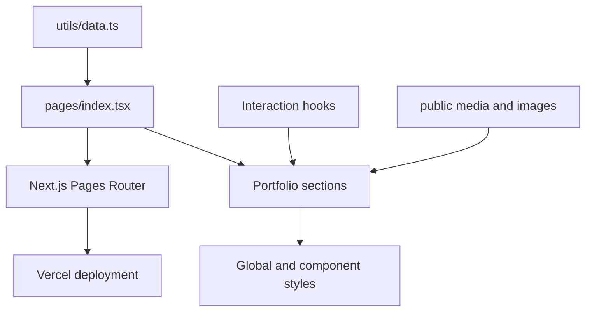

# Sandesh Kumar — Developer Portfolio

A One Piece-inspired engineering portfolio built with Next.js, React, TypeScript, and Tailwind CSS.

The site uses a weathered pirate-paper visual system to present professional experience, technical skills, and selected software projects without turning the portfolio into a generic résumé template.

**Live site:** [sandesh-portfolio-seven.vercel.app](https://sandesh-portfolio-seven.vercel.app/)

## Experience

- Split-screen cinematic landing section with a looping, muted introduction video
- Wanted-poster profile card with an alternate hover portrait
- Professional and education timeline presented as a ship's log
- Technology tags organized from a single typed data source
- Project cards linked to source repositories
- Themed contact section and responsive navigation
- Reduced-motion detection hook for motion-sensitive visitors
- Responsive layouts for mobile, tablet, and desktop
- Custom logo, favicon, parchment textures, typography, and visual effects

## Architecture



Portfolio content is centralized in `utils/data.ts`. The page maps that data into reusable sections, which makes résumé and project updates possible without scattering copy across multiple components.

## Technology stack

| Area | Technology |
| --- | --- |
| Framework | Next.js 16, Pages Router |
| UI | React 19, TypeScript, Tailwind CSS 4 |
| Motion | Framer Motion, GSAP |
| Icons | Lucide React, React Icons |
| State | Zustand |
| Quality | ESLint, Next.js production build |
| Deployment | Vercel |

## Project structure

```text
Sandesh_portfolio/
├── components/       portfolio section components
├── hooks/            animation, pointer, and scroll preferences
├── pages/            Next.js document, app, and home page
├── public/           logo, portraits, video, and visual assets
├── styles/           global visual system
├── utils/
│   ├── data.ts       résumé, skills, and project content
│   └── gsapAnimations.ts
├── next.config.ts
└── tsconfig.json
```

## Local development

### Prerequisites

- Node.js 20+
- npm

### Install and run

```bash
git clone https://github.com/Sandeshkumar0/Sandesh_portfolio.git
cd Sandesh_portfolio
npm install
npm run dev
```

Open `http://localhost:3000`.

## Available commands

| Command | Purpose |
| --- | --- |
| `npm run dev` | Start the development server |
| `npm run build` | Create and validate a production build |
| `npm start` | Serve the production build |
| `npm run lint` | Run ESLint |

Before publishing changes:

```bash
npm run lint
npm run build
```

## Updating portfolio content

Edit `utils/data.ts` to update:

- identity and contact information
- education and experience entries
- skills grouped by discipline
- featured projects, descriptions, technologies, and source links

Keep project descriptions evidence-based. Link to a repository README containing setup instructions, architecture, limitations, and validation results.

## Assets

The main assets under `public/` are:

- `az-logo-brown.png` — site identity and favicon
- `my-pic.jpeg` — primary wanted-poster portrait
- `sanji-bounty.webp` — alternate hover portrait
- `Hey_with_the_help_of_two_image.mp4` — landing video

Large media files directly affect first-load performance. Re-encode replacement video assets for the web and provide poster images for slow connections.

## Design principles

1. **Theme with restraint** — the pirate identity supports the information hierarchy instead of hiding it.
2. **Evidence over percentages** — skills are represented through technologies and projects, not arbitrary proficiency bars.
3. **Progressive motion** — visual movement enhances the experience but should respect reduced-motion preferences.
4. **Data-driven content** — résumé and project content stays separate from presentation code.
5. **Source-first projects** — every featured project should lead to inspectable code and honest documentation.

## Deployment

The production site is deployed on Vercel. Connect the repository to a Vercel project and use the standard Next.js settings:

```text
Build command: npm run build
Output: managed by Next.js
Node.js: 20+
```

Every pull request should pass linting and the production build before deployment.

## Current limitations

- Contact interactions do not yet use a dedicated server-side form service with spam protection.
- The portfolio does not include automated accessibility or browser tests.
- Project case studies currently link to repositories rather than having dedicated routes.
- Large visual assets can be optimized further for bandwidth and Core Web Vitals.
- Some portfolio content is maintained manually and can drift from repository status.

## Roadmap

- Dedicated case-study pages with architecture, screenshots, trade-offs, and outcomes
- Automated project metadata from GitHub with a controlled local fallback
- Accessible contact delivery with validation, rate limiting, and spam protection
- Playwright tests for navigation, responsive layout, and reduced-motion behavior
- Lighthouse budgets enforced in CI
- Open Graph images and structured metadata for project sharing

## Contact

- [GitHub](https://github.com/Sandeshkumar0)
- [LinkedIn](https://www.linkedin.com/in/sandesh-kumar-b425922ab/)
- [Email](mailto:sandeshkr07@gmail.com)

## License

Licensed under the [Apache License 2.0](LICENSE).
